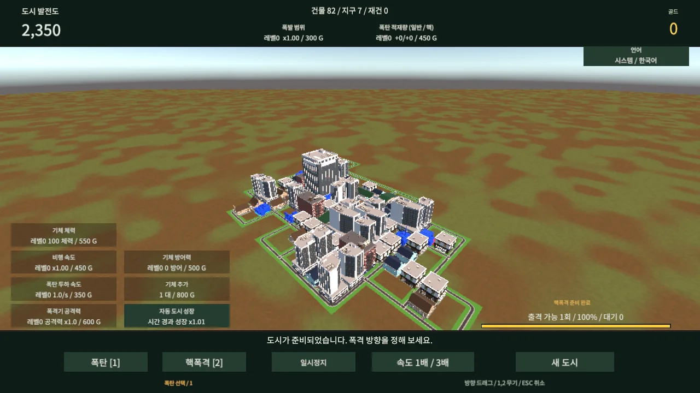

<div align="center">

# GrowingCity

**자동으로 성장하는 도시를 폭격하고 귀환하는 편대로 연속 출격하는 도시 파괴 게임**


[게임 실행](https://mdj0126.github.io/growing-city/) · [다큐먼트](https://mdj0126.github.io/growing-city/Documentation/)



</div>

## 1. 프로젝트 문서

[시스템 언어로 다큐먼트 열기](https://mdj0126.github.io/growing-city/Documentation/)

[English](Documentation/en/README.md) · [한국어](Documentation/ko/README.md) · [日本語](Documentation/ja/README.md) · [简体中文](Documentation/zh-Hans/README.md) · [繁體中文](Documentation/zh-Hant/README.md) · [Deutsch](Documentation/de/README.md) · [Français](Documentation/fr/README.md) · [Español](Documentation/es/README.md) · [Português](Documentation/pt/README.md)

## 2. 이 프로젝트에서는 무엇을 확인할 수 있나요?

처음부터 일부 완성된 도시는 주변으로 한 번에 최대 네 칸씩 성장합니다. 인접 건물은 더 높은 단계로 합쳐지고 파괴된 구역은 다시 건설됩니다. 드래그 방향으로 폭격기가 화면 밖에서 진입해 반대편으로 빠져나갑니다.

파괴로 얻은 골드로 폭탄과 기체를 강화합니다. 귀환 기체 한 대마다 출격 사용권 50%를 회복하므로 편대가 커지면 연속 출격이 가능합니다. 고레벨 건물은 제한 추적 미사일로 대응합니다.

[프로젝트 다운로드 (ZIP)](https://github.com/MDJ0126/growing-city/archive/refs/heads/main.zip)

## 3. 프로젝트 구조

| 경로 | 역할 |
| --- | --- |
| `Assets/Scripts/City` | 성장·전투·입력·동적 상태 |
| `Assets/Scenes/City Prototype.unity` | 게임 씬과 편집 가능한 UI |
| `Assets/Settings`, `Assets/Prefabs` | 프로젝트 소유 설정·머테리얼·Variant |
| `Packages`, `ProjectSettings` | Unity 의존성과 프로젝트 설정 |
| `Documentation` | 9개 언어 문서와 실제 게임 화면 |
| `web` | 고정된 WebGL 산출물과 SHA-256 목록 |
| `Tools`, `QA` | 배포·브라우저 검증과 독립 로직 검사 |

## 4. 개발된 기능 및 작업 규칙

- 초기 96칸 도시, 최대 24×24칸, 시간에 따라 최대 8배 자동 성장, 후반 고레벨 직접 건설.
- 인접 조합 진화와 발전도, 피격·골드·카메라 흔들림, 물리 파편과 다양한 붕괴.
- 파란 연료 저장소·탄약고·발전소의 연쇄 폭발.
- V자 편대, 체력·방어·속도·폭탄 수·투하 속도·폭발 범위 강화.
- 핵폭격은 일반 출격과 별개로 100초 대기하며 3배속·귀환으로 단축되지 않습니다.
- 기본 시스템 언어와 9개 언어 선택. 도시 저장 기능은 없습니다.
- 마우스/터치 드래그: 출격 방향. `1`: 폭탄, `2`: 핵폭격, `Space`: 일시정지, `Esc`: 취소.
- 외부 에셋 원본은 수정하지 않습니다. UI 정적 구성은 씬에 저장합니다.

### 로컬 실행 및 빌드

소스 프로젝트를 열기 전에 [Low Poly Epic City](https://assetstore.unity.com/packages/3d/environments/urban/low-poly-epic-city-202624)를 구매하여 원래 경로에 가져와야 합니다. 공개 저장소에는 상용 에셋 원본이 포함되지 않으므로 해당 원본 없이는 재빌드할 수 없습니다. 플레이 가능한 내장형 WebGL 빌드는 포함됩니다.

Unity 6000.0.83f1과 WebGL Build Support를 설치하고 `Assets/Scenes/City Prototype.unity`를 엽니다. 배치 빌드 메서드는 `GrowingCity.Editor.CityPrototypeBuild.BuildWeb`, 출력은 `Builds/Web`입니다.

```sh
node Tools/prepare-web.mjs
node Tools/package-pages.mjs
node Tools/web-smoke.mjs
```

마지막 명령은 Windows의 독립 headless Chrome을 사용합니다. gzip과 Unity decompression fallback으로 GitHub Pages의 별도 압축 헤더 없이 실행됩니다. Actions는 `web`의 고정 산출물을 게시하며 Unity를 재빌드하지 않습니다.

상용 에셋은 게임에 내장된 형태로만 배포합니다. 폰트 OFL 고지는 폰트 폴더에 보존되어 있습니다. 이 저장소가 외부 에셋의 재배포 권한을 부여하지 않습니다.

## 5. 프로젝트 환경

| 항목 | 버전 |
| --- | --- |
| Unity Editor | 6000.0.83f1 |
| Universal Render Pipeline | 17.0.4 |
| 배포 | WebGL / GitHub Pages |
| 지원 언어 | 한국어·영어·일본어·중국어 간체/번체·독일어·프랑스어·스페인어·포르투갈어 |

독립 검사 233개 시나리오와 699개 언어·쿨타임 검사를 제공합니다. headless 검증 범위는 실제 게임 시작·화면·드래그 출격이며 모든 기기의 성능과 밸런스를 보증하지 않습니다.
